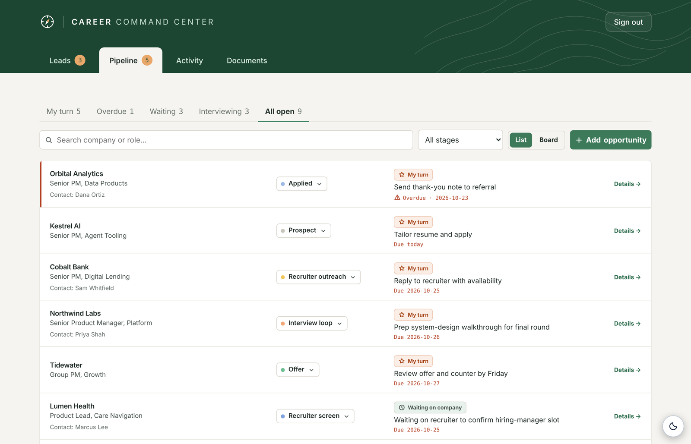
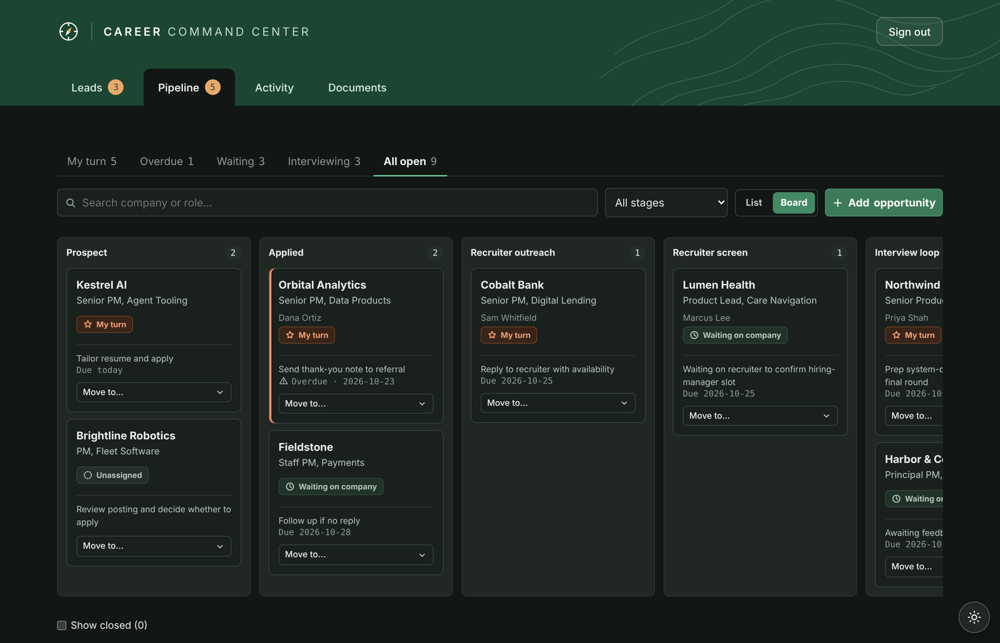
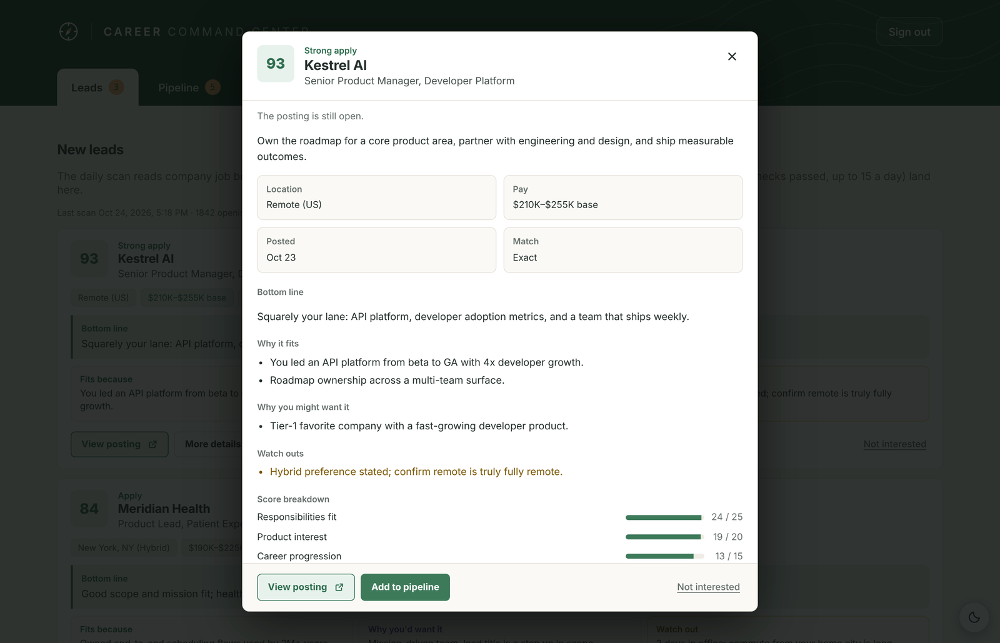
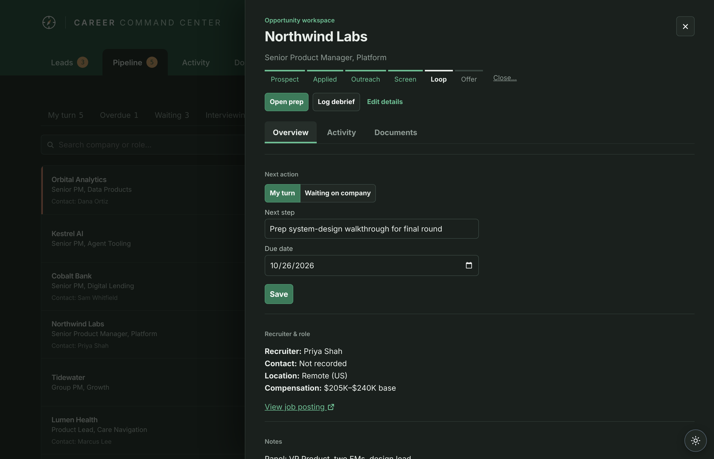
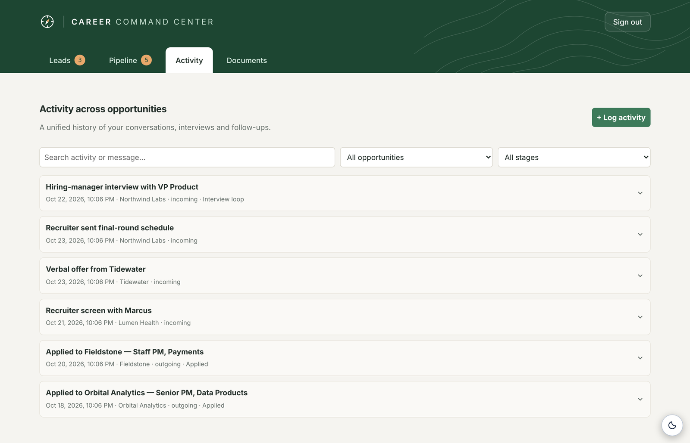
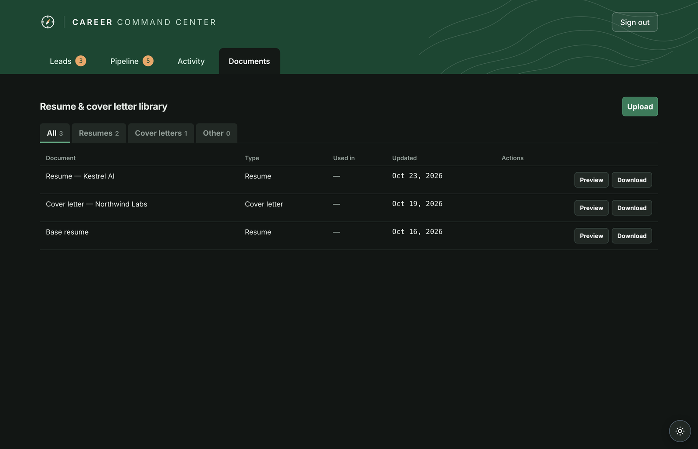
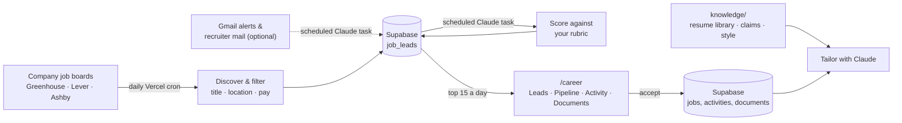

<div align="center">


# Career Command Center

**Your job search, run like a product launch.**
A private job tracker, a daily job-discovery agent and an honest resume tailor, all in one app you own.

[](#free-mode-and-api-mode)
[](https://vercel.com)
[](https://supabase.com)
[](https://claude.ai)
[](#how-it-fits-together)

[Features](#features) · [Screenshots](#a-closer-look) · [Set it up](#set-it-up-in-three-ways) · [How it works](#how-it-fits-together) · [Privacy](#privacy)

<br>

<a href="docs/images/teaser.gif?raw=true" target="_blank"></a>

</div>

---

Job searching is a second job, and most of it is busywork: checking twenty career pages, losing track of who owes whom an email, rewriting the same resume for the hundredth time. **Career Command Center does that busywork for you.** Every day it reads the job boards of the companies you care about, keeps only the roles that clear your title, location and pay rules, has Claude score each one against *your* brief, and hands you a short list to accept or pass on. Accepted leads drop into a pipeline that always tells you what to do next.

It runs on your own **free** Vercel and Supabase accounts, and the AI work uses the Claude plan you already have. No API key, no subscription, no one else's server holding your career history.

## Features

<table>
<tr>
<td width="50%" valign="top">

### 🎯 Leads that already fit
A daily scan of company job boards (Greenhouse, Lever, Ashby) filters by your title, location and pay rules. Claude scores the survivors out of 100 against your own rubric and shows **why it fits, why you'd want it, and what to watch out for**. At most 15 a day, so the list stays readable. Every "not interested" teaches the scorer.

</td>
<td width="50%" valign="top">

### 🧭 A pipeline that knows whose turn it is
Every opportunity has a stage, a next step, a due date and an owner: **you or the company**. Tabs for *My turn*, *Overdue*, *Waiting* and *Interviewing* answer "what should I do today?" at a glance. Switch between list and drag-and-drop board.

</td>
</tr>
<tr>
<td width="50%" valign="top">

### ✍️ Tailoring without fabrication
Pick a job and get a one-page resume assembled from **your approved bullets** plus a cover letter, written only from facts in your knowledge files. A gap check shows which requirements you meet and which to address. Export to PDF or Word.

</td>
<td width="50%" valign="top">

### 📬 Leads from your inbox (optional)
Connect Gmail and a scheduled Claude task turns LinkedIn, Indeed, Glassdoor, Built In and Wellfound alerts, plus recruiter messages, into scored leads and tracker rows.

</td>
</tr>
<tr>
<td width="50%" valign="top">

### 🗂️ One timeline, every document
A unified activity log of calls, emails, interviews and offers, and a versioned library of every resume and cover letter you've sent, linked to the job it went to.

</td>
<td width="50%" valign="top">

### 🔒 Private by design
Magic-link sign-in for your email only, enforced by row-level security in the database *and* a site-wide login gate. Your data lives in your own Supabase project. Light and dark mode, works on your phone.

</td>
</tr>
</table>

## A closer look

<p align="center">
  <a href="docs/images/pipeline-light.png?raw=true" target="_blank"></a>
  <br><sub><b>Pipeline.</b> Stage, owner and next step for every opportunity. Overdue items are flagged.</sub>
</p>

<p align="center">
  <a href="docs/images/board-dark.png?raw=true" target="_blank"></a>
  <br><sub><b>Board view.</b> Drag cards between stages, from Prospect to Offer.</sub>
</p>

<table>
<tr>
<td width="50%"><a href="docs/images/lead-detail-light.png?raw=true" target="_blank"></a><br><sub><b>Lead details.</b> The full evaluation and a seven-part score breakdown.</sub></td>
<td width="50%"><a href="docs/images/opportunity-dark.png?raw=true" target="_blank"></a><br><sub><b>Opportunity workspace.</b> Stage track, next action, contacts, notes and history.</sub></td>
</tr>
<tr>
<td width="50%"><a href="docs/images/activity-light.png?raw=true" target="_blank"></a><br><sub><b>Activity.</b> Every conversation, interview and follow-up in one searchable feed.</sub></td>
<td width="50%"><a href="docs/images/documents-dark.png?raw=true" target="_blank"></a><br><sub><b>Documents.</b> Versioned resumes and cover letters, ready to preview or download.</sub></td>
</tr>
</table>

<sub>Screenshots use made-up demo data.</sub>

## Set it up in three ways

> **About 20 minutes, $0.** You need a GitHub account, a Claude Pro or Max plan, and free Vercel and Supabase accounts.

**1. Have Claude do it (recommended).** Nothing to install, nothing runs on your computer.

1. **Make your own private copy:** [**Use this template →**](https://github.com/jbinder25/career-console/generate) (set Visibility to **Private**).
2. **Connect Claude to your tools:** in claude.ai, Settings, Connectors, connect **GitHub**, **Vercel** and **Supabase** (the rest of [SETUP.md](SETUP.md) Part A has the details).
3. **Start a session** in [Claude Code on the web](https://claude.ai/code) on your new repository, with those connectors on, and paste this (put your own email in first):

```text
Set this up for me following SETUP.md. My sign-in email is you@example.com.
Do Part B step by step with the GitHub, Vercel and Supabase connectors, pause when you need me to do the Supabase dashboard step, never print or commit secrets, and ask me before anything that costs money.
When the site is live and I can sign in, run ONBOARDING.md with me, then set up the daily scoring task from SETUP.md and verify everything on its checklist.
```

**2. Guided.** Read [SETUP.md](SETUP.md) and do Part B yourself, using Claude Code for the commands.

**3. By hand.** Same steps in the Supabase and Vercel dashboards: run `supabase/schema.sql` in the SQL editor, insert the one config row, edit `public/shared/config.js`, import the repo into Vercel (framework "Other"), add the env vars `CRON_SECRET` and `JOB_AGENT_SECRET`, set Supabase's Site URL and Redirect URLs. SETUP.md has every value.

Then make it yours with [ONBOARDING.md](ONBOARDING.md): Claude interviews you (about 10 minutes), fills in your resume library and search settings, and checks the result.

## How it fits together



Static pages and small serverless functions on Vercel; data and sign-in in Supabase. A Vercel cron discovers and filters jobs; a scheduled Claude Code task scores them through the Supabase connector. There is no build step and no framework: plain HTML and JavaScript you can read in one sitting. Full details: the developer guide at `/docs` on your site (source: `public/docs/index.html`).

## Free mode and API mode

| | **Free mode** (default) | API mode (optional) |
|---|---|---|
| Needs | Claude Pro or Max plan | An Anthropic API key (pay per use) |
| Discovery and filtering | Vercel cron | Vercel cron |
| Scoring | Daily scheduled Claude Code task | Vercel cron scores automatically |
| Jobs from email (optional) | Daily scheduled Claude task with Gmail (SETUP.md, "Optional: leads from your inbox") | Same |
| Tailoring | Ask Claude in a session; the Tailor panel gives you the text to paste | Tailor button works in the app |
| Setup | Leave `ANTHROPIC_API_KEY` unset | Set `ANTHROPIC_API_KEY` in Vercel (then you can disable the scheduled task) |

Free mode uses your plan's usage limits; the scoring task handles 15 leads per run. Supabase Free pauses after about 7 days idle, which the daily cron prevents. Vercel Hobby is for personal use.

## Project layout

| Path | What it is |
|---|---|
| `SETUP.md`, `ONBOARDING.md`, `CLAUDE.md` | Setup steps, the onboarding script, standing instructions Claude reads automatically |
| `public/shared/config.js` | Your name, email, Supabase URL and key, timezone |
| `public/career/`, `public/login/`, `public/docs/` | The tracker, sign-in page, developer guide |
| `middleware.js` | Site-wide login gate |
| `api/job-scan.js`, `api/_lib/` | Daily discovery, scoring and surfacing; tailoring; board readers |
| `vercel.json` | Publishing folder, function limits, cron schedule |
| `knowledge/` | Your facts and settings: profile, resume library, style guide, search filters, scoring brief, favorite companies, claims |
| `docs/claude/` | Runbooks for Claude: `score-leads.md` (daily scoring), `tailor-with-claude.md` (resume and letter), `email-leads.md` (optional: jobs from your email) |
| `.claude/skills/` | Claude Code skills, for example `/email-leads` |
| `scripts/leads.mjs` | Helper Claude uses to read the brief and turn scores into SQL |
| `supabase/schema.sql` | The complete database schema (run once on a new project) |
| `tests/` | `node --test` |

## Getting updates

This repository is a snapshot of an app that keeps improving. When the person who shared it exports a new version, they send you a new template or push it to a branch. To take it:

1. Add the source as a remote (`git remote add upstream <url>`) and fetch, or download the new files.
2. Merge the changes into a branch. **Keep your own** `public/shared/config.js`, everything under `knowledge/`, and any changes to `vercel.json` you made.
3. If `supabase/schema.sql` changed, ask Claude to compare it with your live database and apply only the new parts with the Supabase connector (never re-run the whole file on a database that has data).
4. Run `node --test`, push, and check the site after the deploy. Claude can do all of this: "Merge the latest template update, keeping my config and knowledge files, then verify."

## Privacy

- Keep **your copy** of this repository **private**. It will hold your resume and career history.
- Your data lives in your own Supabase project; no one else has access unless you share credentials. Only the email in `config.js` and the database config row can sign in.
- The Supabase publishable key in `config.js` is meant to be public. Never commit `CRON_SECRET`, `JOB_AGENT_SECRET`, an API key, or a Supabase service-role or secret key.
- Job postings are scored by Claude as untrusted text; instructions hidden in a posting are ignored.

## License

[MIT](LICENSE). Use it, change it, and make it your own.

<div align="center">
<br>

**Ready?** Start with [SETUP.md](SETUP.md). After setup, the developer guide lives at `/docs` on your site.

</div>
